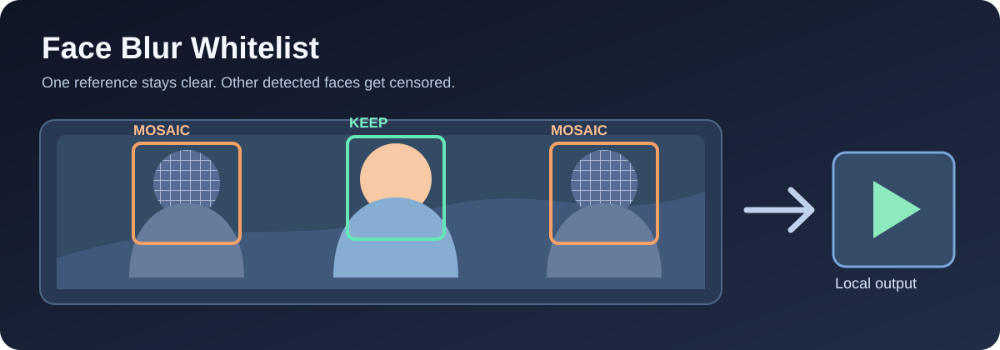

# Face Blur Whitelist

<p align="center">
  
</p>

<p align="center"><strong>Keep one person visible while censoring other detected faces in a video.</strong></p>

I built this local video-processing tool to explore face detection, recognition, and privacy-aware editing. It uses [OpenCV YuNet and SFace](https://github.com/opencv/opencv_zoo) to compare faces with reference photos or a saved profile. Faces that do not match are mosaicked by default; Gaussian blur is also available. FFmpeg writes the video and carries over its audio.

## What it does

- Takes a video plus photos of the person to keep visible, or an enrolled `.npz` profile.
- Detects faces with YuNet and compares their SFace embeddings against the reference.
- Uses a short-lived target track to help follow the reference person between nearby frames.
- Censors every **detected** face except the selected reference person.
- Processes files locally. The code downloads the two OpenCV models on first use; it does not upload your video or profile.

This is a prototype, not a guarantee of anonymity. A missed face, unusual pose, poor lighting, or an incorrect match can leave a person visible. Review the complete output before sharing it.

## Run it

You need Python, FFmpeg on your `PATH`, and the packages in `requirements.txt`.

```bash
python -m venv .venv
source .venv/bin/activate
python -m pip install -r requirements.txt
```

Run with your own reference photos:

```bash
python blur_not_me.py \
  --input /path/to/input.mp4 \
  --output /path/to/output.mp4 \
  --reference /path/to/person-front.jpg /path/to/person-side.jpg \
  --backend cpu \
  --encoder libx264
```

The first run downloads `face_detection_yunet_2023mar.onnx` and `face_recognition_sface_2021dec.onnx` from the [OpenCV Model Zoo](https://github.com/opencv/opencv_zoo) into `models/`. The repository does not include model weights, photos, videos, or enrolled face profiles.

### Reuse a face profile

```bash
python enroll_face_profile.py \
  --images /path/to/person-front.jpg /path/to/person-side.jpg \
  --output profiles/person.npz

python blur_not_me.py \
  --input /path/to/input.mp4 \
  --output /path/to/output.mp4 \
  --profile profiles/person.npz \
  --backend cpu \
  --encoder libx264
```

The profile contains biometric face embeddings. Keep it private, along with the source photos and video. The repository ignores these files by default.

## Options

| Need | Option |
| --- | --- |
| Soft blur instead of mosaic | `--effect blur` |
| Censor more aggressively when a wrong person stays clear | Raise `--keep-threshold` (default `0.38`) |
| Keep the target visible through difficult poses | Lower `--keep-threshold`, then review the result carefully |
| Faster processing | Lower `--scale` (default `0.5`; may miss small faces) |
| Test a short clip | `--max-frames 300` |
| Use CUDA-backed OpenCV, if installed and available | `--backend auto` or `--backend cuda` |
| Use NVIDIA encoding, if available | `--encoder h264_nvenc` |

`--backend auto` attempts CUDA when OpenCV reports a compatible device, then falls back to CPU if model setup fails. The pip-installed OpenCV wheel normally uses CPU for its DNN backend. `--encoder auto` chooses `h264_nvenc` if FFmpeg lists it, otherwise `libx264`; if your GPU cannot actually run NVENC, pass `--encoder libx264` explicitly.

## Project status

The repository contains the processing and enrollment scripts, not a hosted app or a published accuracy benchmark. The code has been checked for syntax and CLI startup; privacy and match quality depend on the video and must be reviewed by a person.
